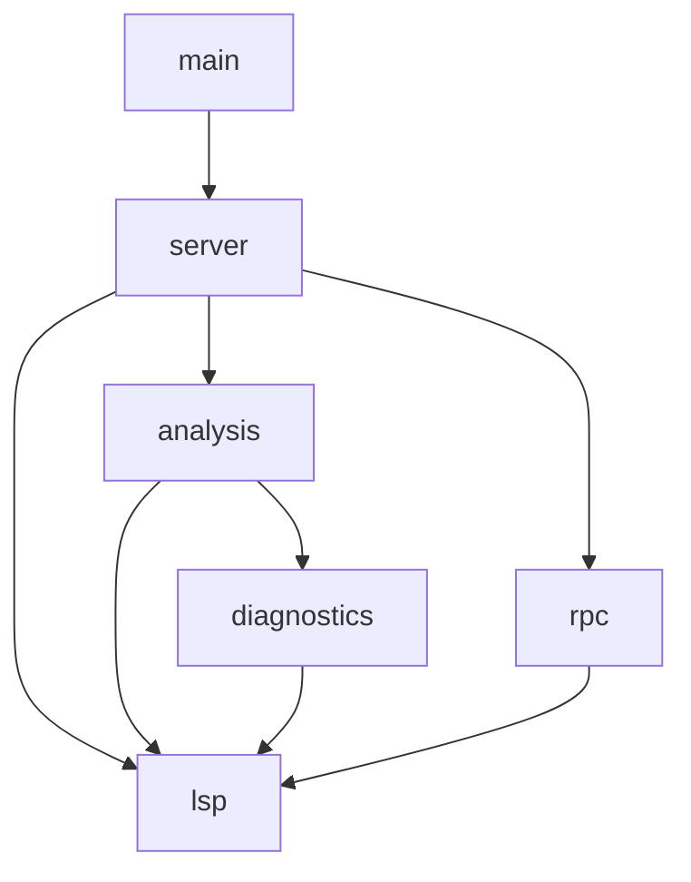
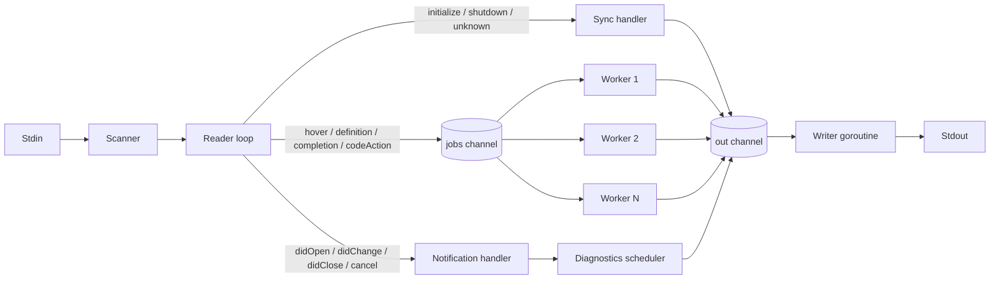
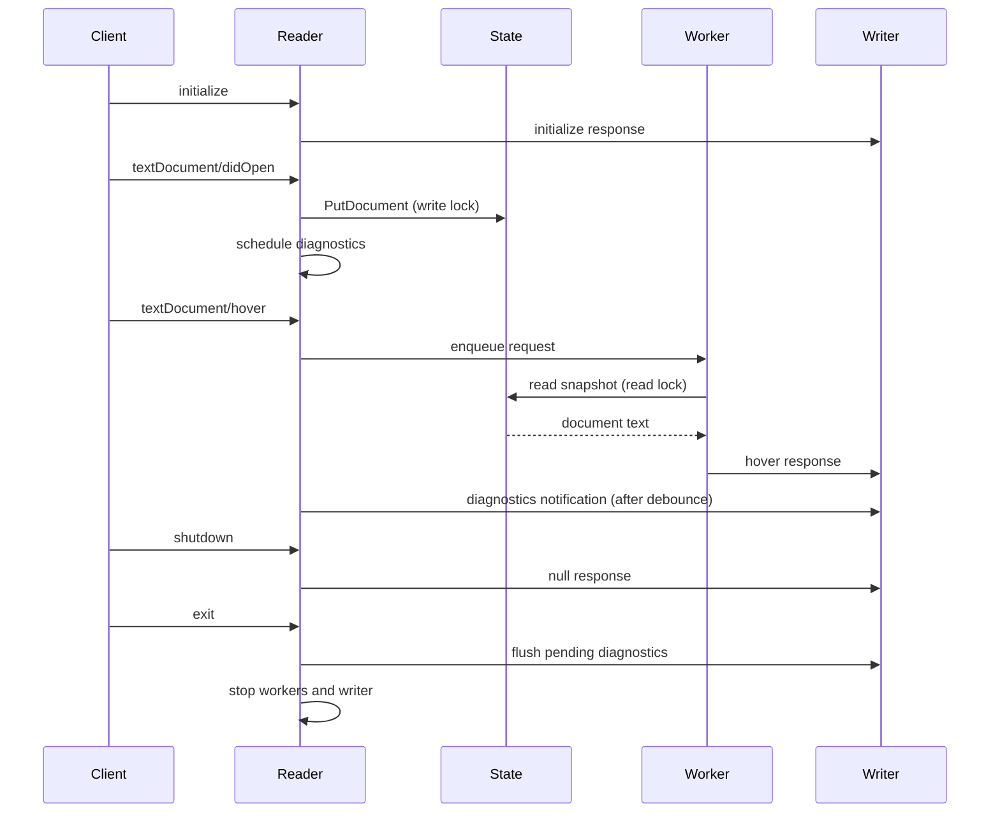

# read_lsp Architecture

This document explains how `read_lsp` is put together, how messages move through
the server, and where to extend it.

## 1. Design Goals

`read_lsp` is intentionally small, but it is built around real concurrency and
protocol boundaries:

- **Editor-agnostic:** everything is standard LSP over JSON-RPC 2.0 on
  stdin/stdout.
- **Markdown-only:** language behavior follows the Markdown Guide basic syntax.
- **Single-writer output:** concurrent handlers never interleave protocol frames.
- **Bounded concurrency:** requests use a worker pool instead of unbounded
  goroutines.
- **Ordered notifications:** document open/change/close events are processed in
  the order the client sent them.
- **Thread-safe state:** editor buffers can be read and written concurrently.
- **Non-blocking feedback:** diagnostics are computed off the reader path and
  coalesced per document.
- **No third-party runtime dependencies:** the server uses the Go standard
  library only.

## 2. Package Layout

| Package | Responsibility |
| --- | --- |
| `main` | Flags, log file, signal handling, process lifecycle. |
| `server` | Reader loop, dispatch, worker pool, writer, cancellation, diagnostics scheduling. |
| `analysis` | Thread-safe document store and hover, definition, references, document-symbol, folding, completion, and code-action features. |
| `diagnostics` | Markdown document model, parser, slug generation, and syntax diagnostics. |
| `rpc` | Content-Length framing, scanning, message decoding, request metadata. |
| `lsp` | Protocol request, response, notification, and data types. |

Dependency direction:



## 3. Transport Layer

LSP messages on stdio are framed as:

```text
Content-Length: <byte-count>\r\n
\r\n
<JSON body>
```

`rpc.Split` implements `bufio.SplitFunc` and emits exactly one complete frame.
It waits for a complete body when a frame arrives in pieces. `rpc.DecodeMessage`
and `rpc.DecodeMessageBase` parse the headers and decode the JSON body.

`BaseMessage` captures:

- `jsonrpc`
- `id` (absent for notifications)
- `method`

`BaseMessage.IsRequest` distinguishes requests from notifications by checking
for a non-null `id`. `BaseMessage.RequestKey` is used for cancellation.

The server configures a scanner buffer starting at 64 KiB and growing up to
32 MiB, so large documents are not rejected by the scanner's default limit.

## 4. Server Runtime

`server.Server` owns the runtime state for one connection. Its main components
are:



### Reader loop

`Serve` reads one framed message at a time. For each message it:

1. Copies the scanner token. The scanner buffer is reused by the next `Scan`, so
   the copy is required before handing the bytes to an asynchronous worker.
2. Decodes the base message.
3. Stops immediately on `exit`.
4. Routes requests to either the synchronous path or the worker pool.
5. Routes notifications to the notification handler in the reader goroutine.

### Synchronous path

The following requests are handled inline in the reader loop:

- `initialize`
- `shutdown`
- any request whose method is not one of the async methods
- unknown methods, which receive `-32601` (method not found)

Handling `initialize` synchronously guarantees that its response is enqueued
before any request that follows can produce a response. Clients rely on this
ordering.

### Worker pool

The async request methods are:

- `textDocument/hover`
- `textDocument/definition`
- `textDocument/references`
- `textDocument/documentSymbol`
- `textDocument/foldingRange`
- `textDocument/codeAction`
- `textDocument/completion`

They run on a bounded worker pool (`Options.Workers`, default `4`). Requests are
queued on a buffered channel sized at `workers * 8`. This gives concurrency
without creating an unbounded number of goroutines under load.

### Serialized writer

All output, including responses and diagnostics, goes through one `out` channel
drained by a single writer goroutine. `rpc.EncodeMessage` is called only on that
goroutine's path, so two responses can never interleave bytes on stdout.

`enqueue` protects the channel with a mutex and an `outClosed` flag. This makes
late diagnostic callbacks safe during shutdown: they either enqueue normally or
are dropped after the writer has closed.

## 5. Concurrency and Ordering Guarantees

| Concern | Guarantee |
| --- | --- |
| Notification order | `didOpen`, `didChange`, and `didClose` are processed sequentially in the reader loop. |
| Request concurrency | Hover, definition, references, document symbols, folding ranges, completion, and code action run concurrently on up to `Workers` goroutines. |
| Output integrity | One writer goroutine serializes every frame. |
| Initialize ordering | The initialize response is enqueued before later messages are read. |
| State access | Every document access goes through `analysis.State`'s `sync.RWMutex`. |
| Stale diagnostics | Unique schedule tokens discard results scheduled before a newer edit. |
| Cancellation | `$/cancelRequest` cancels the matching request context; canceled requests receive `-32800`. |

Notifications are deliberately not parallelized. A `didChange` must be applied
before a later `hover` reads the same document, so the reader updates state
before dispatching the hover request.

## 6. Document State

`analysis.State` stores Markdown buffers:

```go
type document struct {
    text string
}

type State struct {
    mu        sync.RWMutex
    documents map[string]document
}
```

The map is private. Public methods acquire the appropriate lock and never expose
the map or a mutable document:

- `PutDocument` takes a write lock and stores text.
- `ReplaceDocument` takes a write lock and replaces text.
- `OpenDocument` and `UpdateDocument` store text and return synchronous analysis
  for direct API use.
- `CloseDocument` removes the document.
- `DocumentText` and `Diagnostics` take a read lock and return a snapshot.
- `Hover`, `Definition`, `References`, `DocumentSymbols`, `FoldingRanges`,
  `TextDocumentCodeAction`, and `TextDocumentCompletion` read a snapshot before
  doing analysis, so parsing does not hold the lock.

## 7. Markdown Model

`diagnostics.Parse` produces a `diagnostics.Document` containing:

- `Lines`: normalized text split on line endings.
- `Headings`: ATX headings, Setext headings, levels, source ranges, and slugs.
- `Definitions`: link reference definitions, destinations, titles, and validity.
- `Fences`: fenced code block markers, info strings, and closing lines.

The parser is single-pass over lines:

1. A fence opener captures a run of at least three backticks or tildes, at the
   top level or inside a blockquote. All lines until a matching closing fence
   with the same blockquote depth are marked as fence content and skipped by
   the rest of the parser.
2. Container prefixes are stripped for blockquotes and list markers. A link
   reference definition is then recognized at up to three spaces of indentation.
   The destination may be bare or wrapped in angle brackets, and the optional
   title may be quoted with `"`, `'`, or parentheses.
3. A Setext underline promotes the previous non-empty text line to a level 1 or
   level 2 heading when that line can be paragraph text. List items are excluded
   from Setext promotion.
4. An ATX heading captures the marker run, optional space, text, and closing
   hashes. Headings can appear inside blockquotes and list items.
5. A thematic break is recorded for lines made of at least three `*`, `-`, or
   `_` characters separated by spaces.

Lookup helpers answer questions used by diagnostics and editor features:

- `HeadingAt`, `DefinitionAt`, and `FenceAt` by line.
- `DefinitionFor` by normalized label.
- `HeadingForAnchor` and `AnchorExists` by slug.
- `IsSetextUnderline`, `IsThematicBreak`, and `IsDefinitionLine`.

Slugs are generated from heading text: lowercase letters, digits, `-`, and `_`
are kept, whitespace becomes `-`, other punctuation is dropped, and duplicate
slugs receive `-1`, `-2`, and so on.

## 8. Diagnostics Pipeline

Diagnostics are push-based. The server sends
`textDocument/publishDiagnostics` notifications rather than implementing pull
diagnostics.

### Scheduling

The reader only stores the new buffer contents through `PutDocument` or
`ReplaceDocument`; it never parses source in the reader goroutine. After
`didOpen` or `didChange`, the server calls `scheduleDiagnostics(uri)`:

1. Allocate a new globally unique token and record it as the latest token for
   the URI.
2. Stop the previous timer for that URI.
3. Start a new timer (`Options.DiagnosticsDebounce`, default `75ms`).

When the timer fires, the diagnostic goroutine compares its token with the
URI's latest token. If a newer edit has been scheduled, the result is discarded.
Otherwise it computes diagnostics and publishes them.

This gives three useful properties:

- Rapid typing does not run analysis for every keystroke.
- Only the newest document version can publish.
- The reader loop never blocks on parsing.

On `didClose`, the server cancels any pending timer and publishes an empty
diagnostic list so the client clears the buffer's markers. A publication mutex
orders final diagnostic frames against close and shutdown, so a late timer
cannot resurrect markers after the clear.

On shutdown, `flushDiagnostics` stops all pending timers and publishes the
latest diagnostics for each pending URI.

### Analysis

`diagnostics.Analyze(text)` parses the document once and produces diagnostics
with a stable `Code`, `Source`, `Severity`, `Range`, and `Message`.

Block checks:

- ATX heading level greater than six.
- Missing space between an ATX marker and its text.
- Unclosed fenced code blocks.

Line checks, skipping fences, definitions, Setext underlines, and thematic
breaks:

- Inline code spans with no matching closing run of backticks.
- Autolinks with no closing `>`.
- Inline links with no closing `)` or an invalid destination/title.
- Full, collapsed, and shortcut reference links, including the optional space
  between link text and label, whose normalized label has no definition.
- Local anchors whose slug does not match any heading.
- Odd emphasis delimiter counts for `*` and `_`, ignoring intraword
  underscores, delimiters surrounded by whitespace, and masked code, autolink,
  HTML, and link-destination text.
- Ordered list markers that use `)` instead of `.`.

Document checks:

- Duplicate link reference definitions.
- Link reference definitions with no destination.

The diagnostic codes are:

| Code | Meaning |
| --- | --- |
| `markdown.heading-level` | Heading depth exceeds six. |
| `markdown.heading-space` | ATX marker is not followed by a space. |
| `markdown.unclosed-fence` | Fenced code block has no closing fence. |
| `markdown.inline-code` | Inline code backtick run is unclosed. |
| `markdown.emphasis` | An emphasis delimiter is unpaired. |
| `markdown.unclosed-link` | Inline target or reference label is unclosed. |
| `markdown.invalid-link` | Inline destination or title is malformed. |
| `markdown.undefined-reference` | Reference label has no definition. |
| `markdown.duplicate-reference` | Label is defined more than once. |
| `markdown.invalid-definition` | Definition has no destination. |
| `markdown.missing-anchor` | Local anchor does not match a heading. |
| `markdown.autolink` | Autolink has no closing `>`. |
| `markdown.list-marker` | Ordered list marker uses `)` instead of `.`. |

The emphasis check is a lightweight delimiter heuristic, not the full CommonMark
delimiter-stack algorithm. The parser follows basic Markdown syntax rather than
every CommonMark edge case.

## 9. Editor Features

### Hover

`State.Hover` finds the element under the cursor and returns Markdown:

- Fenced code blocks: marker, info string, and open/closed state.
- Headings: level, text, syntax, and anchor.
- Link reference definitions: label, destination, title, and target heading.
- Inline code: the code text.
- Inline, reference, and image links: text, label, destination, title, and
  target heading.
- Autolinks and email autolinks: display text and destination.
- Inline HTML tags: the tag text.

### Go to definition

`State.Definition` returns a `*lsp.Location` or `nil`:

- Reference link or shortcut link to its link reference definition.
- Anchor link or anchor definition to the matching heading.
- No fallback location when the cursor is not on a resolvable Markdown element.

### References

`State.References` locates uses of a link reference label or a local anchor. It
returns full link ranges plus the declaration when the client requests it:

- Label references include the definition and every full, collapsed, or
  shortcut use of that label.
- Anchor references include every link or definition targeting the heading.
- A heading itself can be used as the starting point for anchor references.

### Document symbols and folding

`State.DocumentSymbols` returns nested Markdown headings using LSP
`DocumentSymbol` ranges. `State.FoldingRanges` returns heading sections and
fenced code blocks.

### Completion

Completion is snippet-based (`InsertTextFormat: 2`) and replaces the current
line prefix with a `TextEdit`:

- A line made only of `#` characters offers six heading levels.
- An empty line offers headings, links, images, autolinks, emphasis, lists,
  blockquotes, fenced code, and reference definitions.
- A line starting with backticks or tildes offers a plain fenced block plus
  snippets for common languages. A language name or info string after the
  markers filters the list, and enclosing blockquote prefixes are preserved.
- A line starting with `[` offers inline and reference links.
- A line starting with `![` offers inline and reference images.
- A line starting with `<` offers URL and email autolinks.
- List-marker-only lines offer list and task-list snippets.

### Code actions

`State.TextDocumentCodeAction` filters diagnostics by the requested `Range` and
returns quick fixes:

- Insert a space after an ATX heading marker.
- Replace an over-deep heading marker with six hashes.
- Append a closing fence.
- Delete duplicate or invalid link reference definitions.
- Append a missing link reference definition.
- Close an inline code run, link target, reference label, autolink, or emphasis
  span.
- Replace an ordered list marker `)` with `.`.

## 10. Request Lifecycle



## 11. Configuration

`server.Options` provides:

| Option | Default | Purpose |
| --- | --- | --- |
| `Logger` | discard | Internal logging. |
| `State` | `analysis.NewState()` | Shared document store, primarily for tests. |
| `Workers` | `4` | Async request concurrency. |
| `DiagnosticsDebounce` | `75ms` | Per-document diagnostic delay; `0` means immediate timer. |

The binary exposes `-log` and `-version` flags. Logging always goes to a file,
never stdout.

## 12. Extending the Server

### Add an LSP request

1. Add request/response types under `lsp/`.
2. Add a method on `analysis.State` that takes a document snapshot.
3. Add a case in `server.(*Server).handleRequest`.
4. Decide whether it is async by adding it to `isAsyncRequest`.
5. Advertise the capability in `lsp/initialize.go`.
6. Add a test in `server/server_test.go`.

Notifications follow the same pattern: add a typed struct in `lsp/`, parse it in
`handleNotification`, and update state in the reader goroutine if ordering
matters.

### Add a Markdown diagnostic

1. Add a code constant in `diagnostics/diagnostics.go`.
2. Implement the check against `diagnostics.Document` or a line scan.
3. Append it from `Analyze` and keep results sorted by line and character.
4. Add a quick fix in `analysis.codeActionFor` when the fix is safe.
5. Add table-driven tests in `diagnostics/diagnostics_test.go`.

Diagnostics must be pure functions of the document text. They must not read
global state or block on I/O.

## 13. Testing Strategy

- `rpc/rpc_test.go` covers framing, scanning, additional headers, and short
  bodies.
- `lsp/initialize_test.go` verifies the initialize response shape.
- `diagnostics/document_test.go` covers headings, slugs, fences, definitions,
  and destination parsing.
- `diagnostics/diagnostics_test.go` covers Markdown syntax diagnostics.
- `analysis/state_test.go` covers hover, definition, references, document
  symbols, folding ranges, completion, code actions, and concurrent state
  access under the race detector.
- `server/server_test.go` exercises the real server with framed input, async
  requests, diagnostics flushing, document close, and unknown methods.

Run everything with:

```sh
go test -race ./...
```

## 14. Limitations and Roadmap

Current limitations:

- Full-text document sync only; incremental range edits are not applied.
- Position handling currently assumes byte offsets for column characters.
- The Markdown parser and emphasis checks cover basic syntax, not every
  CommonMark edge case.
- Diagnostics are push-only; pull diagnostics (`textDocument/diagnostic`) is not
  implemented.
- No workspace indexing, rename, formatting, or semantic tokens yet.

Natural next steps:

- Incremental document updates and version tracking.
- UTF-16 position conversion for full LSP correctness.
- Richer Markdown diagnostics and code actions.
- Pull diagnostics, workspace document symbols, and Markdown formatting.
