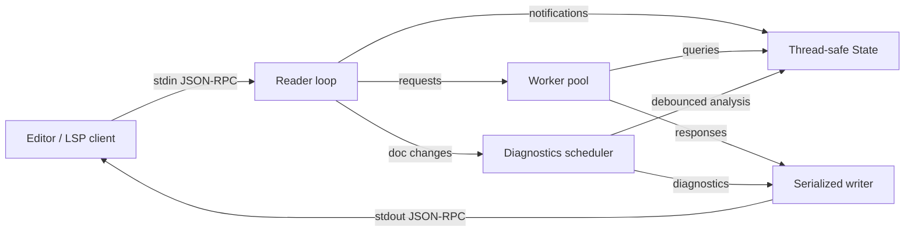

# read_lsp

A small, Markdown-only Language Server Protocol server written in Go.

`read_lsp` speaks JSON-RPC 2.0 over stdin/stdout, keeps editor buffers in a
thread-safe document store, processes requests concurrently, and streams
diagnostics back to the client. The language features follow the
[Markdown Guide basic syntax](https://www.markdownguide.org/basic-syntax/).

[](https://go.dev/)
[](LICENSE)


## Features
- **LSP from scratch in Go** using only the standard library for transport,
  framing, and JSON-RPC handling.
- **Asynchronous request multiplexing** with a bounded worker pool, a dedicated
  serialized writer, and `$/cancelRequest` support.
- **Thread-safe document state** protected by `sync.RWMutex`.
- **Markdown syntax support** for ATX and Setext headings, fenced code blocks,
  link reference definitions, thematic breaks, links, images, autolinks, inline
  HTML tags, list markers, blockquote prefixes, and inline code spans.
- **Streaming diagnostics** with per-document debouncing, stale-result
  suppression, and a final flush on shutdown.
- **Editor features** including diagnostics, hover, go to definition, find
  references, document symbols, folding ranges, snippet completion, and
  quick-fix code actions.
- **Neovim integration** for Markdown buffers.

## Supported LSP Methods

| Method | Type | Status |
| --- | --- | --- |
| `initialize` | Request | Supported |
| `initialized` | Notification | Supported |
| `shutdown` | Request | Supported |
| `exit` | Notification | Supported |
| `textDocument/didOpen` | Notification | Supported |
| `textDocument/didChange` | Notification | Supported (full sync) |
| `textDocument/didClose` | Notification | Supported |
| `textDocument/publishDiagnostics` | Notification | Supported |
| `textDocument/hover` | Request | Supported |
| `textDocument/definition` | Request | Supported |
| `textDocument/references` | Request | Supported |
| `textDocument/documentSymbol` | Request | Supported |
| `textDocument/foldingRange` | Request | Supported |
| `textDocument/completion` | Request | Supported |
| `textDocument/codeAction` | Request | Supported |
| `$/cancelRequest` | Notification | Supported |

## Quick Start

```sh
git clone https://github.com/atharva-0123-cs/read_lsp.git
cd read_lsp
make build
./read_lsp -version
```

The server speaks LSP on stdin/stdout. To connect Neovim, see
[INSTALL.md](INSTALL.md), or use the included [`markdown_lsp.lua`](markdown_lsp.lua):

```lua
vim.lsp.start({
  name = "read_lsp",
  cmd = { vim.fn.exepath("read_lsp") },
  root_dir = vim.fn.getcwd(),
})
```

## Architecture at a Glance



The reader preserves notification ordering, request handlers run concurrently,
and a single writer owns stdout so frames are never interleaved. See
[DOCS.md](DOCS.md) for a complete architecture walkthrough.

## Project Layout

```text
.
├── main.go                 Entry point, flags, logging, signal handling
├── server/                 Async LSP server, dispatch, worker pool, cancellation
├── analysis/               Thread-safe state and Markdown editor features
├── diagnostics/            Markdown parser, document model, and diagnostics
├── rpc/                    Content-Length framing and JSON-RPC helpers
├── lsp/                    LSP protocol types
├── markdown_lsp.lua        Neovim client configuration
├── README.md               Project overview
├── INSTALL.md              Installation and editor setup
└── DOCS.md                 Architecture and internals
```

## Development

Requirements: Go 1.21 or newer.

```sh
make build      # build ./read_lsp
make test       # go test ./...
make race       # go test -race ./...
make vet        # go vet ./...
make fmt        # gofmt all Go sources
```

Run a single package's tests with:

```sh
go test ./diagnostics
go test ./analysis
go test ./server
```

## Markdown Support

The parser recognizes:

- ATX headings (`# Heading`) and Setext headings (`Heading` underlined with
  `===` or `---`).
- Blockquote prefixes, including nested markers, and fenced code blocks inside
  blockquotes.
- Ordered and unordered list markers.
- Fenced code blocks, info strings, and unclosed fences.
- Inline links, full/collapsed/shortcut reference links, images, autolinks,
  email autolinks, and link reference definitions with optional titles.
- Inline code spans for unclosed-span diagnostics and hover.
- Inline HTML tags for masking and hover.
- Thematic breaks.
- ATX headings and link reference definitions inside blockquotes and list
  items, plus Setext headings inside blockquotes.

Diagnostics check for:

- Heading levels deeper than six and missing spaces after heading markers.
- Unclosed fenced code blocks, inline code spans, and autolinks.
- Unclosed or malformed links and unmatched emphasis delimiters.
- Undefined reference labels and duplicate or invalid link reference
  definitions.
- Local anchors that do not match any heading.
- Ordered list markers that use `)` instead of `.`.

Hover shows heading metadata, fenced-code details, link and autolink
destinations, reference definitions, inline HTML, and inline code. Go to
definition jumps from a reference link to its definition and from an anchor to
its heading. Find references locates link uses and anchor targets. Document
symbols expose nested headings, and folding ranges cover headings and fenced
code. Completion provides Markdown snippets for ATX headings, links, images,
autolinks, emphasis, lists (including task items), blockquotes, fenced code,
and reference definitions. Code actions can add a heading space, limit heading
depth to six, close a fence, inline code span, link, reference label, autolink,
or emphasis span, fix ordered list markers, remove duplicate or invalid
definitions, and add missing reference definitions.

Known Markdown support gaps are tracked in [TODO.md](TODO.md).

## Contributing

Contributions are welcome. Please:

1. Keep changes scoped and add tests for protocol or parser behavior.
2. Run `make fmt`, `make vet`, and `make race` before opening a pull request.
3. Update [DOCS.md](DOCS.md) when changing the server architecture.
4. Include manual Neovim testing notes when changing LSP behavior.

## License

MIT. See [LICENSE](LICENSE).
